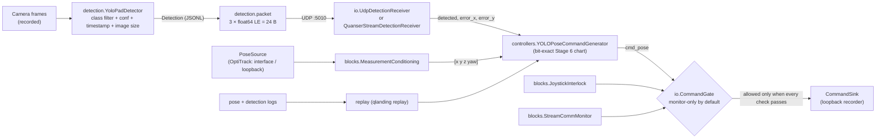

# Quanser autonomous landing: Python port

Python port of the QDrone YOLO landing-pad pipeline that was built in
MATLAB/Simulink + QUARC. The baseline is
`reference/simulink/QDrone_YOLO_Stage6_RealYOLO_MonitorOnly.slx` ("Stage 6").
The originals stay in `reference/` untouched.

## At a glance

| Area | Status | How it is checked |
|---|---|---|
| Stage 6 `YOLOPoseCommandGenerator` | ✅ ported | **Bit-exact vs Octave** running the extracted chart: 9 900 steps (+ 985 with descent enabled), 0 ulp difference |
| Recenter chart, legacy MATLAB controllers, Extract Object Data, comm-loss chart | ✅ ported | Bit-exact vs Octave (20 723 chart steps in total across all fixtures) |
| Mutation sweep | ✅ 48 / 48 mutants killed | Every controller rule broken once; all killed by the Octave parity tests alone, by failed assertions (0 errors, 0 timeouts) |
| Simulink wiring, endpoints, constants | ✅ extracted | `tools/slx_spec.py` → `docs/spec/`, key facts asserted in `tests/test_spec.py` |
| QUARC block equivalents (Threshold, Inverse Modulus, joystick, conditioning) | ⚠️ ported, **not oracle-verified** | Unit tests against the documented behaviour |
| YOLO inference on recorded frames | ⚠️ plumbing works | The supplied `models/yolo11n.pt` is the **stock COCO YOLO11n** (no landing-pad class) |
| UDP 5010 detection link | ✅ socket version tested · ⚠️ Quanser `Stream` version untested | Loopback UDP test; Quanser SDK not installed here |
| OptiTrack, camera, QDrone command output | ⚠️ interfaces + loopback only | Packet types and vehicle model not in the repo |
| Simulink execution, hardware, flight | ❌ not verified | No MATLAB, no QUARC, no hardware, no recorded logs |

Monitor-only is the default everywhere. Descent is disabled, as in Stage 6.

## Pipeline



## Findings from the Simulink models (details in [docs/SIMULINK_SPEC.md](docs/SIMULINK_SPEC.md))

* **F1**: in Stage 6 the QDrone's Desired Pose comes from `Switch1`, whose
  in3 is wired to the *Mode switch* (a scalar 0/1), so with `use_yolo = 0`
  the vehicle is sent `[m, m, m, m]`. In the Integration model it was the
  follower/home pose. Looks like an accidental rewire.
* **F2**: the detection Stream Server's `new` flag is only displayed; a dead
  sender's last packet is reused forever (state 3 can persist on a stale
  frame).
* **F3**: communication loss only raises a host warning; it does not gate
  commands on the host.
* Detection link: `udp://localhost:5010?peer=any`, receive-only, 3 doubles,
  little-endian, 33 ms. QDrone link: `tcpip://localhost:18002`
  (`URI_Follower`), QBot `tcpip://localhost:18001` (`URI_Leader`), 1 ms.

## Plots

Generated from real runs by `python tools/make_plots.py` into `docs/plots/`
(gitignored, so run it locally):

* `parity_sequence.png`: Python vs Octave on a random sequence, the loss-decay
  case and the 10-update case, with the difference (identically 0).
* `parity_error.png`: worst |Python − Octave| per output over every fixture step.
* `scenario_replay.png`: a **synthetic** closed-loop replay showing F2, the
  held packet ageing after the sender stops.
* `mutation_sweep.png`: per-mutant outcome (needs `tools/mutation_sweep.py --json outputs/mutation_sweep.json` first).

## How to run

```bash
python -m venv .venv && . .venv/bin/activate
pip install -e ".[dev]"            # controllers, replay, tests (no runtime deps)
pip install -e ".[detect,plots]"   # optional: ultralytics (CPU), matplotlib

pytest -q                           # all tests; YOLO tests skip without ultralytics
python tools/verify_snapshot.py     # originals byte-for-byte + extracted charts
python tools/slx_spec.py --check    # spec in docs/spec matches the .slx files
python tools/make_parity_fixtures.py --check   # needs GNU Octave (octave-cli)
python tools/mutation_sweep.py --json outputs/mutation_sweep.json
python tools/make_plots.py

# Replay logs (CSV poses: timestamp_s,x,y,z,yaw; detections: JSONL or CSV timestamp_s,detected,error_x,error_y)
qlanding scenario --out-dir outputs/scenario            # synthetic logs, clearly labelled
qlanding replay --poses outputs/scenario/poses_seed0.csv \
                --detections outputs/scenario/detections_seed0.jsonl --out outputs/replay.csv

# YOLO on recorded frames (classes and confidence are required on purpose)
qlanding detect --frames path/to/frames --weights models/yolo11n.pt --classes <class> --conf 0.5 --fps 30 --out outputs/det.jsonl

# Stage 6 UDP link, monitor-only (prints what the controller would command)
qlanding udp-monitor --port 5010
qlanding udp-send --detections outputs/det.jsonl --port 5010 --realtime --rescale
```

## Layout

* `src/quanser_landing/controllers/`: Stage 6 generator, recenter logic, legacy controllers.
* `src/quanser_landing/blocks/`: MATLAB Function charts and Simulink/QUARC block equivalents, joystick interlock.
* `src/quanser_landing/detection/`: detection contract, 5010 packet codec, YOLO wrapper.
* `src/quanser_landing/io/`: interfaces, UDP and Quanser Stream receivers, loopback adapters, `CommandGate`.
* `src/quanser_landing/replay.py`, `scenario.py`, `cli.py`.
* `tools/`: `slx_spec.py`, `make_parity_fixtures.py` + `octave/parity_driver.m`, `mutation_sweep.py`, `make_plots.py`, `verify_snapshot.py`.
* `docs/`: [SIMULINK_SPEC.md](docs/SIMULINK_SPEC.md), [PORT_NOTES.md](docs/PORT_NOTES.md), [PYTHON_PORT.md](docs/PYTHON_PORT.md), `spec/`, `source_manifest.json`.
* `reference/`: original models, extracted charts, legacy MATLAB and experiments (unchanged).

## What is not verified

* Nothing has run in Simulink or QUARC; Octave stands in for MATLAB on the
  MATLAB Function charts only.
* The QUARC block equivalents follow the block parameters and documentation.
* No hardware, no recorded flight logs or camera frames were available. The
  replay plot uses synthetic data.
* `models/yolo11n.pt` is byte-identical to the official Ultralytics YOLO11n
  release (80 COCO classes); a landing-pad checkpoint is needed.
* The Quanser `Stream` adapter is written against the documented API but was
  not executed (SDK not installed).

## Notes

Text originals are checked out with CRLF (see `.gitattributes`) so that
`tools/verify_snapshot.py` matches the recorded checksums on every platform.
`tools/dataset_legacy/` scripts use machine-specific paths and some delete
their output directories; review before running. No license was supplied;
copied Quanser/library content and the checkpoint keep their existing rights.
