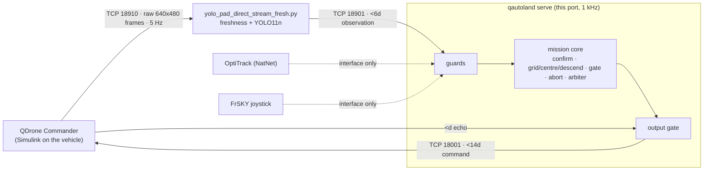
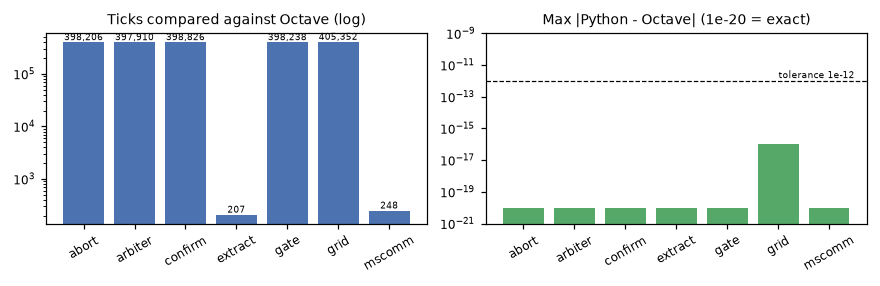
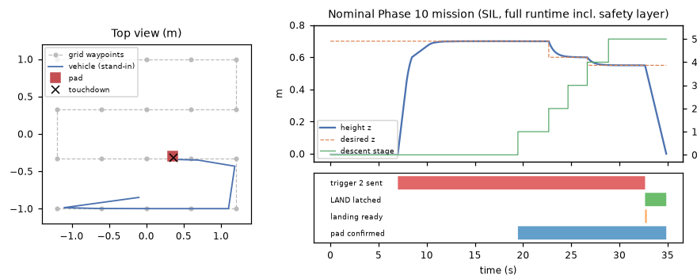
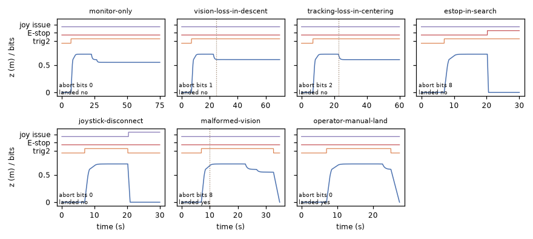
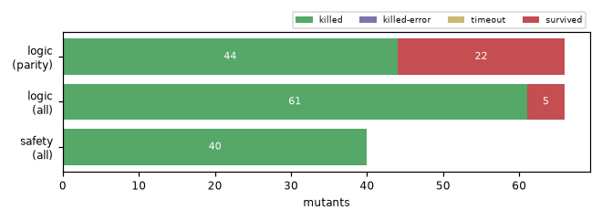

# QDrone autonomous landing: Phase 10 in Python

This repository holds the QDrone YOLO autonomous-landing project
(MATLAB R2021b / Simulink / QUARC) and a Python port of its Phase 10 mission
server, the `simulink/Mission_Server_QDrone_YOLO_Autonomous_Land.mdl` model.
The port talks to the unchanged vehicle model
(`QDrone_YOLO_Direct_Stream_Commander.mdl`) and the unchanged vision publisher
(`python/yolo_pad_direct_stream_fresh.py`) using their exact wire formats.



## Status at a glance

| Part | State | Evidence |
|---|---|---|
| Model reading | done: both `.mdl` files parsed directly by `tools/mdl_spec.py` into `docs/spec/` | `mdl_spec.py --check` in CI |
| Mission logic: 7 MATLAB Function blocks | ported, explicit state + `reset()` | Octave runs the chart code taken from the model. 30 committed sequences (188 k ticks): 27 exact, 3 grid sequences differ by at most 1.1e-16. All 8 closed-loop scenarios (1.81 M ticks) are exact |
| Block chains (convention correction, conditioning, home pose, joystick, comm loss) | ported from the block parameters | unit tests; not checkable against Simulink here |
| Original MATLAB tests | `test_phase9_landing_gate`, `test_phase9_abort_diagnostics` pass **unmodified** in Octave 9.4. The phase 10 dry run's behavioural half is re-run in Octave and its structural half is checked on the parsed model | `tools/octave/run_original_tests.m`, `tests/test_spec.py` |
| Model code vs `matlab/phase*.txt` templates | identical once `config_autonomous()` is substituted | `tools/octave/check_templates.m` |
| Wire formats (`<6d`, `<14d`, `<d`, column-major frames) | done | protocol tests; `yolo_pad_direct_stream_fresh.py` runs unmodified as a subprocess, fed synthetic frames over TCP 18910 |
| Tests | 131 pytest tests (Octave and vision ones skip without their tools) + the original `python/test_camera_freshness.py` | CI: lint+tests, Octave, vision |
| Safety layer (guards, output gate, fail-stop) | done, on the only runtime path | `docs/SAFETY.md`, fuzz and scenario tests; safety mutation sweep killed 40 of 40 |
| Logic mutation sweep | 61 of 66 killed (44 by the Octave fixtures alone). The 5 survivors are argued equivalent or boundary-only in `tools/mutation_sweep.py` | `docs/figures/data/mutation_logic.json` |
| Phase 10 autonomous LAND | ported faithfully, **off by default** (`--mode monitor`) | arbiter parity + scenarios |
| Sockets: mission server <-> Commander, <- publisher | done, loopback-tested | `tests/test_sockets.py`, `qautoland loopback` |
| OptiTrack NatNet client, game-controller reader | **not implemented** (interfaces only). `serve` is inert without them | |
| Flight / QUARC / Simulink | **not run**: no hardware, MATLAB or QUARC was available | |

## Figures

All figures come from real runs, made by `python tools/make_figures.py`.



The nominal mission: grid search, YOLO confirmation, constant-altitude centring,
descent 0.70 -> 0.60 -> 0.55 m, ten fresh observations, then LAND. It runs in
closed loop against a simple stand-in vehicle and camera (`src/qdrone_autoland/sim.py`).
The stand-in is not a flight model.



Fault scenarios through the full runtime: height, then the Takeoff/Land,
E-stop and joystick-issue bits actually sent to the Commander.



Mutation sweeps: each rule is broken once and a test must fail. "parity" means
the Octave fixtures alone; "all" means the whole suite.



## Running it

```bash
python -m venv .venv && . .venv/bin/activate
pip install -e ".[dev]"                 # add ".[vision]" for the YOLO publisher
pytest -q                               # Octave and vision tests skip if octave-cli / ultralytics are missing
qautoland sim                           # all closed-loop scenarios, one JSON line each
qautoland loopback --duration 5         # publisher -> mission server -> Commander on 127.0.0.1 with fake peers
qautoland replay logs/yolo_direct_fresh_<stamp>.csv   # what the confirmation block makes of a recorded session
qautoland serve --mode dry-run          # real sockets, sends nothing
```

`qautoland serve` replaces the Simulink mission server: it listens on TCP 18001
for the Commander and connects to the publisher on 127.0.0.1:18901. Modes:

* `dry-run`: computes everything and sends nothing.
* `monitor` (default): Phase 9 behaviour. Only the operator lands.
* `autoland`: needs `--i-understand-autoland`. Faithful Phase 10.

Until a NatNet client and a joystick reader are plugged into
`io/sources.py`, it reports `isTracking = 0` and a disconnected joystick, so
the Commander will not fly.

Regenerate the evidence:

```bash
python tools/mdl_spec.py                     # docs/spec from the .mdl files
python tools/make_fixtures.py                # Octave golden fixtures (needs octave-cli)
python tools/make_fixtures.py --check        # byte-identical regeneration
python tools/mutation_sweep.py --sweep logic  --json docs/figures/data/mutation_logic.json
python tools/mutation_sweep.py --sweep safety --json docs/figures/data/mutation_safety.json
python tools/make_figures.py
```

More detail: [interfaces](docs/INTERFACES.md), [safety layer](docs/SAFETY.md),
model digests in [docs/spec](docs/spec).

## What the models reveal

These are facts about the saved models that matter for anyone flying this.
None was changed. The port reproduces them, and `test_sim.py` pins several of them.

* Every autonomous landing ends with `descentAbort` latched and abort bit 8,
  because the measured height drops below 0.45 m during LAND. The diagnostic
  therefore always reports an "abort" after a successful Phase 10 landing.
* A NaN hold pose at centring entry makes the grid manager command the
  geofence corner (-1.2, -1.0): MATLAB `min(max(NaN, lo), hi)` gives `lo`.
  The port's pose guard and output gate prevent both the input and the jump.
* The mission server's comm-loss warning is display only, and it appears only
  after the first recovery (Triggered Subsystem x Product). Its rule is
  `!(state == 2 && error >= 0)` after 1 s; the Commander's is
  `state ~= 2 && error < 0` after 3 s.
* The YOLO confirmation keeps `lastFrame` across takeoff cycles. A restarted
  publisher whose frame counter lands on the old value loses one frame.
* The mission server ignores the publisher's timestamp (`vision(6)`). The
  Python vision guard adds an age check against it.
* Dwell counts are in ticks (100 ticks = 0.1 s at 1 kHz), so the Python loop
  keeps exact model time.
* The OptiTrack block's calibration file is an absolute lab path
  (`Session 2026-09-15`), not `config/Calibration_2026-08-11.cal`. The
  Commander's external-mode target is 192.168.2.16, while `config_autonomous`
  says the QDrone is 192.168.2.15. The Commander's "Data Out [14]" selects 13
  elements.

## Python vision setup

From this repository root:

```powershell
python -m venv .venv
.\.venv\Scripts\Activate.ps1
python -m pip install -r requirements.txt
python -m unittest discover -s python -p "test_*.py"
python python/yolo_pad_direct_stream_fresh.py
```

The direct stream path receives Commander camera frames on TCP 18910 and publishes observations on TCP 18901. This command starts vision only; it does not launch the MATLAB mission server or vehicle. `python/qdrone_camera_streamer.py` is a separate vehicle-side alternative requiring the separately installed Quanser Python SDK; it is not needed for the existing direct-stream Commander path.


## Original project notes

Source: `E:\berkay\Quanser_Clean\QDrone_Autonomous_Landing`.
This replaces the unrelated synced-project snapshot previously committed here.

## Selected current implementation

- Mission server: `simulink/Mission_Server_QDrone_YOLO_Autonomous_Land.mdl` (Phase 10).
- Vehicle: `simulink/QDrone_YOLO_Direct_Stream_Commander.mdl`.
- Ground vision: `python/yolo_pad_direct_stream_fresh.py`, with its local helper modules included. The original `yolo_pad_direct_stream.py` is also retained; run only one vision publisher at a time.
- Trained detector: `models/qdrone_landing_pad_yolo11n_v3_best.pt`.
- Mission parameters: `matlab/config_autonomous.m`.
- Site calibration: `config/Calibration_2026-08-11.cal` and `config/RigidBody_01.tra`.

This is a copy of the user's current working project, selected by source inspection. No flight, MATLAB model update, or hardware build was performed during packaging. The protected `working_grid_search_2026-08-13` baseline has its own recorded working-status notes.

## Included files

The original folder layout is preserved so relative imports, model generation, weights, and calibration dependencies remain available. All handwritten MATLAB/Python sources, controller templates, tests, source-original models, intermediate phase models, and the protected working grid-search baseline are included. Earlier phases are dependencies and comparison references, not alternative current entry points.

Generated QUARC/C/C++ builds, compiled targets, model caches/autosaves, recordings, runtime detection files, logs, and duplicate backup directories are excluded. The original milestone-1 README is preserved in `docs/ORIGINAL_MILESTONE1_README.md`; it predates the current landing implementation.

### Porting notes (original)

Use the saved Phase 10 model as the behavioral reference, with `matlab/phase8_grid_manager_code.txt`, `phase9_landing_gate_code.txt`, `phase9_abort_diagnostic_code.txt`, and `phase10_autoland_arbiter_code.txt`. Preserve the existing packet layouts, camera freshness logic, coordinate transforms, camera offset, flight bounds, operator triggers, communication-loss behavior, and landing-readiness gate. Existing phase 9 and phase 10 MATLAB tests are included as behavioral specifications.

The build scripts form a phase chain and some refuse to overwrite existing models. Do not rerun the full chain against this snapshot without reading each script. The saved models may contain absolute lab paths; resolve those to the copied calibration files in MATLAB before building on another machine. MATLAB R2021b, QUARC, Quanser libraries, Motive/OptiTrack, and the lab hardware remain external prerequisites. Python dependencies are listed without invented version pins; the original environment did not supply a lockfile.

`docs/source_manifest.json` records original file hashes and paths. Apart from this README, copied source files are unchanged. No Python flight-control port has been added during packaging.
