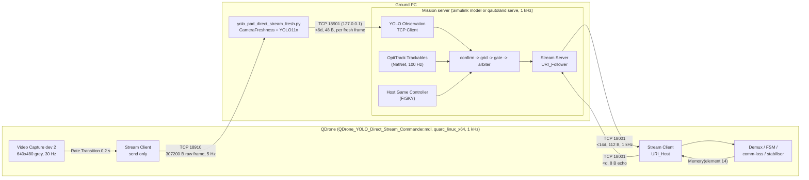
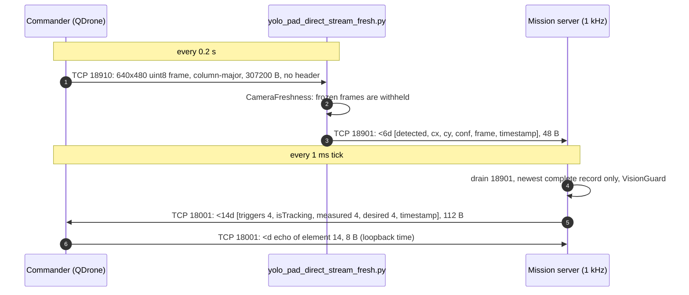
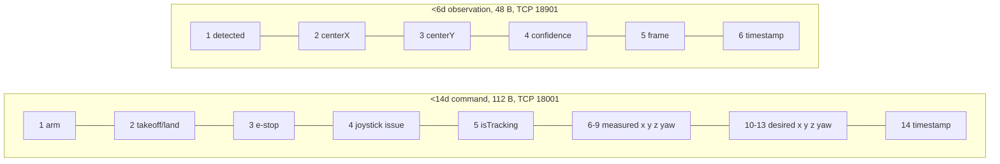

# Phase 10 interfaces

Everything below comes from the two model files, parsed by `tools/mdl_spec.py`
(digests in `docs/spec/`), and from `python/yolo_pad_direct_stream_fresh.py`.
`tests/test_spec.py`, `tests/test_protocol.py` and `tests/test_vision_interop.py`
check that the Python port still matches them.

*Endpoints, rates and payload sizes as read from the two `.mdl` files by
`tools/mdl_spec.py`: digests
[Mission_Server_QDrone_YOLO_Autonomous_Land.md](spec/Mission_Server_QDrone_YOLO_Autonomous_Land.md)
and [QDrone_YOLO_Direct_Stream_Commander.md](spec/QDrone_YOLO_Direct_Stream_Commander.md),
kept fresh by `mdl_spec.py --check` in CI.*

*One cycle of the three links, in the order the Python port exercises them in
`tests/test_vision_interop.py` (the real publisher as a subprocess, fed
synthetic frames over TCP 18910) and `qautoland loopback` /
`tests/test_sockets.py` (mission server to a fake Commander and back).*

*Field order of `protocol.COMMAND` and `protocol.VISION`, checked by
`tests/test_protocol.py`, `tests/test_spec.py` (the model's root Mux) and
`tests/test_vision_interop.py` (the publisher's own packets).*

## Links

| Link | Transport | Server side | Client side | Payload | Rate | Evidence |
|---|---|---|---|---|---|---|
| Camera frames | TCP 18910 | publisher `make_camera_listener` on `0.0.0.0` | Commander "Direct Grayscale TCP Stream" Stream Client, `tcpip://192.168.2.11:18910`, send FIFO 1, 1 MB send buffer, nothing received | 640x480 `uint8`, "MATLAB greyscale (HxW)", column-major, 307200 bytes, no header | 0.2 s (camera at `ceil(1/30 / step)` steps, then Rate Transition) | Commander spec; `receive_frame(order="F")` |
| Observations | TCP 18901, `127.0.0.1` only | publisher `LatestObservationServer` (accepts on publish, non-blocking, drops the client on any send error) | mission server "YOLO Observation TCP Client" `tcpip://localhost:18901`, receive most recent, default `[0 0 0 0 -1 0]` | `<6d` = `[detected, centerX, centerY, confidence, frame, timestamp]`; not-detected sends zeros for 2-4; frame = raw frame index; timestamp = `time.time()` at publish | one per fresh frame with a non-stale result | `yolo_pad_writer_passive.py`, MS spec |
| Commands | TCP 18001 | mission server Stream Server, `URI_Follower = tcpip://localhost:18001` (Python binds `0.0.0.0`) | Commander Stream Client `URI_Host = tcpip://192.168.2.11:18001` | `<14d` = Triggers(4) `[arm, takeoff/land, e-stop, joystick issue]`, isTracking, measured pose `[x y z yaw]`, desired pose `[x y z yaw]`, timestamp (wall clock) | every 1 ms step, send most recent | root Mux in the MS spec |
| Loopback | same socket, reverse | Commander -> MS | | `<d`: element 14 echoed through a Memory block | 1 kHz | Commander spec |

All Stream blocks: little endian, `send_dimensions = off`, `receive_dimensions = off`,
data type back-propagated (every signal resolves to `double`).

## Signals inside the mission server

| Signal | Source | Notes |
|---|---|---|
| Rigid body | OptiTrack Trackables (id 1) at `step*10` (100 Hz) -> Convention Correction -> Rate Transition (IC 0) | `xyz_RSF = R' * xyz_MF`, `R = [0 -1 0; 0 0 1; -1 0 0]`; attitude via YZX -> ZYX "prevent gimbal lock" |
| Measured pose | Measurement Conditioning | bias `[0 0 -0.07]`, saturation `[-2 -2 0]..[2 2 5]`, yaw unwrapped (Inverse Modulus 2*pi) |
| Home pose | Calculate Home Pose | captured during a 1 s one-shot after the arm edge, only once `Clock > 5`; z + 0.70 |
| Operator triggers | JOYSTICK | E-stop = button 1 held 0.2 s; arm = button 2; takeoff = Rz >= -0.5; joystick issue = all six axes == -1 for 0.2 s (arm/takeoff forced to 0); outputs held until the first `new` edge |
| Vision | YOLO Observation TCP Client out 3 (vector) and out 4 (new) | |
| Charts | Grid Search Manager (23), YOLO Confirmation (65), Landing Readiness Gate (82), Abort Diagnostic (99), Autonomous LAND Trigger Arbiter (114), Extract Object Data (46), comm-loss (56) | verbatim in `docs/spec/<model>/charts/` |
| Triggers to the Commander | arbiter out 1 | only element 2 may be lowered |
| Comm issue | Detect Communication loss -> Threshold 0.1 s -> Triggered Subsystem x Product | display only |

## Commander behaviour the mission server relies on

* Data Out selects elements `[1:13]` (labelled "[14]"); Demux into triggers,
  isTracking, measured and desired pose.
* Comm loss (after `t > 3`): stream loss when `state ~= 2 && error < 0`
  (0.1 s threshold); data loss when element 14 does not change for 0.5 s
  (and is > 0). FLIGHT SAFETY stops the model after 1 s of comm loss while
  armed; HIL watchdog 0.1 s.
* FSM: comm, joystick or tracking issue -> Error. In AUTO_LAND (state 6) a
  return of trigger 2 to 1 is an Error -> emergency stop.

## Python implementation

| Model part | Python |
|---|---|
| Stream Client 18901 | `io.sockets.VisionClient` (non-blocking, drains, reconnects) + `safety.VisionGuard` |
| Stream Server 18001 | `io.sockets.CommanderServer` (single client, state 2 when connected, drop-not-queue, partial writes completed) |
| Everything between | `mission_server.MissionServerCore` (`blocks.py`, `logic/`) |
| OptiTrack Trackables | `io.sources.PoseSource` **interface only**, no NatNet client yet |
| Host Game Controller | `io.sources.JoystickSource` **interface only** |
| Wire formats | `protocol.py` |
