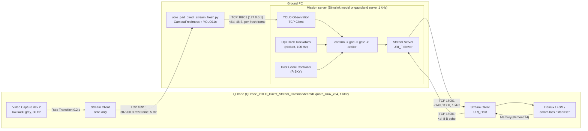
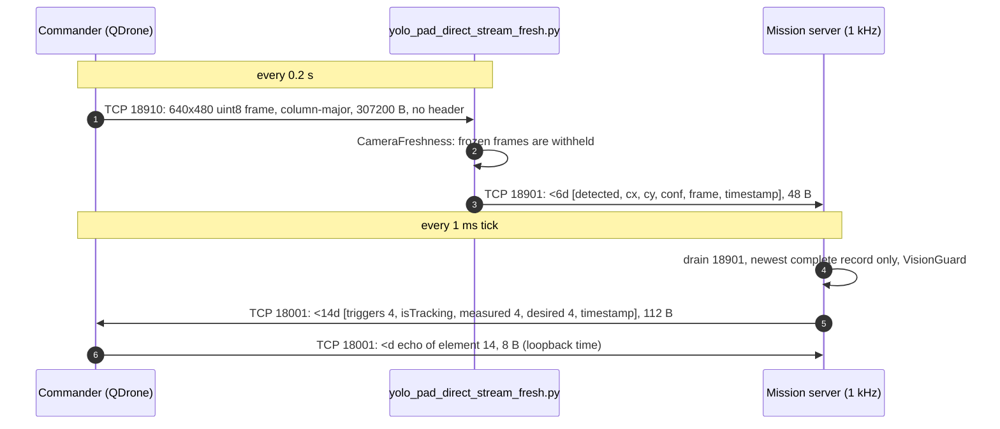
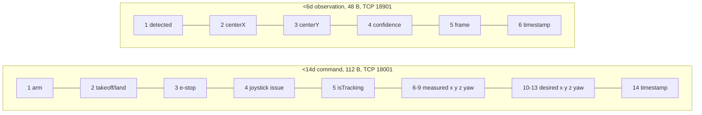

# Phase 10 interfaces

Everything below comes from the two model files, parsed by `tools/mdl_spec.py`
(digests in `docs/spec/`), and from `python/yolo_pad_direct_stream_fresh.py`.
`tests/test_spec.py`, `tests/test_protocol.py` and `tests/test_vision_interop.py`
check that the Python port still matches them.

*Endpoints, rates and payload sizes as read from the two `.mdl` files by
`tools/mdl_spec.py`: digests
[Mission_Server_QDrone_YOLO_Autonomous_Land.md](spec/Mission_Server_QDrone_YOLO_Autonomous_Land.md)
and [QDrone_YOLO_Direct_Stream_Commander.md](spec/QDrone_YOLO_Direct_Stream_Commander.md),
kept fresh by `mdl_spec.py --check` in CI.*

*One cycle of the three links, in the order the Python port exercises them in
`tests/test_vision_interop.py` (the real publisher as a subprocess, fed
synthetic frames over TCP 18910) and `qautoland loopback` /
`tests/test_sockets.py` (mission server to a fake Commander and back).*

*Field order of `protocol.COMMAND` and `protocol.VISION`, checked by
`tests/test_protocol.py`, `tests/test_spec.py` (the model's root Mux) and
`tests/test_vision_interop.py` (the publisher's own packets).*

## Measured traffic

The tables below are captured traffic, not a description: the unmodified
publisher fed frames over TCP 18910, every 48-byte observation it sent back,
and one 112-byte command with the 8-byte echo from a loopback run. They are
written into this file by `python tools/evidence.py interop`
([script](../tools/evidence.py), data
[interop.json](figures/data/interop.json); the same tables standalone in
[evidence/interop.md](evidence/interop.md)). The Commander socket's
drop-not-queue and no-torn-records behaviour is pinned by
`tests/test_sockets.py`. The loopback run below shows the round trip at
1 kHz: commands sent and records received complete, the fake Commander echoing
the newest record's timestamp, and the loopback time the mission server
computes from that echo.

<!-- interop-capture:begin (tools/evidence.py interop) -->
### Interop capture: decoded packets

Captured by [`tools/evidence.py`](../tools/evidence.py) `interop` on Linux x86_64, Python 3.12.15, 2026-10-20; raw data in [interop.json](figures/data/interop.json). The first part is the same set-up as `tests/test_vision_interop.py`: the unmodified `python/yolo_pad_direct_stream_fresh.py` as a subprocess, fed 640x480 frames over TCP 18910 by a stand-in for the Commander's camera stream, read on TCP 18901 by the port's `VisionClient`. The synthetic frames contain no pad, so every observation is a non-detection (detection quality needs recorded imagery).

#### Camera frames sent (TCP 18910) and observations received (TCP 18901)

| # | frame | bytes | image(1,1) | image(2,1) | image(1,2) | wire bytes 1, 2 | observations received after it |
|---|---|---|---|---|---|---|---|
| 1 | fresh | 307200 | 254 | 193 | 227 | 254, 193 | 1 |
| 2 | fresh | 307200 | 182 | 115 | 243 | 182, 115 | 1 |
| 3 | fresh | 307200 | 232 | 254 | 16 | 232, 254 | 1 |
| 4 | fresh | 307200 | 44 | 60 | 174 | 44, 60 | 1 |
| 5 | frozen (first copy) | 307200 | 54 | 100 | 51 | 54, 100 | 1 |
| 6 | frozen (repeat) | 307200 | 54 | 100 | 51 | 54, 100 | 0 |
| 7 | frozen (repeat) | 307200 | 54 | 100 | 51 | 54, 100 | 0 |
| 8 | frozen (repeat) | 307200 | 54 | 100 | 51 | 54, 100 | 0 |

Wire byte 2 is image(2,1), not image(1,2): the stand-in sends each frame column-major, with no header. That this is the order the publisher expects is its decode line, `reshape((HEIGHT, WIDTH), order="F")` in [`python/yolo_pad_direct_stream.py`](../python/yolo_pad_direct_stream.py#L52-L57) (`receive_frame`, imported by the fresh publisher); the non-detection observations above cannot show orientation.

8 frames sent, 5 observations received: one per fresh frame and one for the first copy of the frozen frame; its repeats are withheld. Publisher log: `CAMERA STALE: raw frame repeated 1 times; no detection sent`.

Each observation as received (48 bytes, `<6d`, grouped per double) and decoded:

| # | 48 bytes (hex) | detected | centerX | centerY | confidence | frame | timestamp |
|---|---|---|---|---|---|---|---|
| 1 | `0000000000000000 0000000000000000 0000000000000000 0000000000000000 000000000000f03f 2cb3fc4e07b6da41` | 0 | 0 | 0 | 0 | 1 | 1792548155.948 |
| 2 | `0000000000000000 0000000000000000 0000000000000000 0000000000000000 0000000000000040 59faff4e07b6da41` | 0 | 0 | 0 | 0 | 2 | 1792548156.000 |
| 3 | `0000000000000000 0000000000000000 0000000000000000 0000000000000000 0000000000000840 a7c4014f07b6da41` | 0 | 0 | 0 | 0 | 3 | 1792548156.028 |
| 4 | `0000000000000000 0000000000000000 0000000000000000 0000000000000000 0000000000001040 08d1034f07b6da41` | 0 | 0 | 0 | 0 | 4 | 1792548156.060 |
| 5 | `0000000000000000 0000000000000000 0000000000000000 0000000000000000 0000000000001440 6929224f07b6da41` | 0 | 0 | 0 | 0 | 5 | 1792548156.534 |

#### Mission server to Commander (TCP 18001) and the echo

A `qautoland loopback`-style run on 127.0.0.1 (monitor mode, static pose, arm from 6 s, fake publisher at 5 Hz) for 8062 ticks: 8062 commands sent, 0 dropped, 8062 complete 112-byte records received by the fake Commander ([`io/loopback.py`](../src/qdrone_autoland/io/loopback.py)), of which it decoded and echoed 7286: like the Commander's "Receive most recent data", it decodes only the newest complete record of each read. Server stopped: no. The capture refuses to write if the fake Commander thread raised, fewer than 90 % of ticks were sent, no packet arrived, the echo matches no command sent, or the loopback time is not between 0 and 1 s.

Last command, 112 bytes (`<14d`): `000000000000f03f 0000000000000000 0000000000000000 0000000000000000 000000000000f03f 0000000000000000 cdccccccccccecbf 0000000000000000 0000000000000000 0000000000000000 cdccccccccccecbf 666666666666e63f 0000000000000000 62a6375207b6da41`

| element | field | value |
|---|---|---|
| 1 | arm | 1 |
| 2 | takeoff/land | 0 |
| 3 | e-stop | 0 |
| 4 | joystick issue | 0 |
| 5 | isTracking | 1 |
| 6 | measured x | 0 |
| 7 | measured y | -0.9 |
| 8 | measured z | 0 |
| 9 | measured yaw | 0 |
| 10 | desired x | 0 |
| 11 | desired y | -0.9 |
| 12 | desired z | 0.7 |
| 13 | desired yaw | 0 |
| 14 | timestamp | 1792548168.869530 |

Echo, 8 bytes (`<d`): `9295375207b6da41` = 1792548168.868504, the last value the mission server decoded from the Commander side; it equals element 14 (timestamp) of an earlier command: True. Loopback time measured by the mission server on its last tick: 1.026 ms (the echo is 1.026 ms older than the last command's timestamp).
<!-- interop-capture:end -->

## Links

| Link | Transport | Server side | Client side | Payload | Rate | Evidence |
|---|---|---|---|---|---|---|
| Camera frames | TCP 18910 | publisher `make_camera_listener` on `0.0.0.0` | Commander "Direct Grayscale TCP Stream" Stream Client, `tcpip://192.168.2.11:18910`, send FIFO 1, 1 MB send buffer, nothing received | 640x480 `uint8`, "MATLAB greyscale (HxW)", column-major, 307200 bytes, no header | 0.2 s (camera at `ceil(1/30 / step)` steps, then Rate Transition) | Commander spec; `receive_frame(order="F")` |
| Observations | TCP 18901, `127.0.0.1` only | publisher `LatestObservationServer` (accepts on publish, non-blocking, drops the client on any send error) | mission server "YOLO Observation TCP Client" `tcpip://localhost:18901`, receive most recent, default `[0 0 0 0 -1 0]` | `<6d` = `[detected, centerX, centerY, confidence, frame, timestamp]`; not-detected sends zeros for 2-4; frame = raw frame index; timestamp = `time.time()` at publish | one per fresh frame with a non-stale result | `yolo_pad_writer_passive.py`, MS spec |
| Commands | TCP 18001 | mission server Stream Server, `URI_Follower = tcpip://localhost:18001` (Python binds `0.0.0.0`) | Commander Stream Client `URI_Host = tcpip://192.168.2.11:18001` | `<14d` = Triggers(4) `[arm, takeoff/land, e-stop, joystick issue]`, isTracking, measured pose `[x y z yaw]`, desired pose `[x y z yaw]`, timestamp (wall clock) | every 1 ms step, send most recent | root Mux in the MS spec |
| Loopback | same socket, reverse | Commander -> MS | | `<d`: element 14 echoed through a Memory block | 1 kHz | Commander spec |

All Stream blocks: little endian, `send_dimensions = off`, `receive_dimensions = off`,
data type back-propagated (every signal resolves to `double`).

## Signals inside the mission server

| Signal | Source | Notes |
|---|---|---|
| Rigid body | OptiTrack Trackables (id 1) at `step*10` (100 Hz) -> Convention Correction -> Rate Transition (IC 0) | `xyz_RSF = R' * xyz_MF`, `R = [0 -1 0; 0 0 1; -1 0 0]`; attitude via YZX -> ZYX "prevent gimbal lock" |
| Measured pose | Measurement Conditioning | bias `[0 0 -0.07]`, saturation `[-2 -2 0]..[2 2 5]`, yaw unwrapped (Inverse Modulus 2*pi) |
| Home pose | Calculate Home Pose | captured during a 1 s one-shot after the arm edge, only once `Clock > 5`; z + 0.70 |
| Operator triggers | JOYSTICK | E-stop = button 1 held 0.2 s; arm = button 2; takeoff = Rz >= -0.5; joystick issue = all six axes == -1 for 0.2 s (arm/takeoff forced to 0); outputs held until the first `new` edge |
| Vision | YOLO Observation TCP Client out 3 (vector) and out 4 (new) | |
| Charts | Grid Search Manager (23), YOLO Confirmation (65), Landing Readiness Gate (82), Abort Diagnostic (99), Autonomous LAND Trigger Arbiter (114), Extract Object Data (46), comm-loss (56) | verbatim in `docs/spec/<model>/charts/` |
| Triggers to the Commander | arbiter out 1 | only element 2 may be lowered |
| Comm issue | Detect Communication loss -> Threshold 0.1 s -> Triggered Subsystem x Product | display only |

## Commander behaviour the mission server relies on

* Data Out selects elements `[1:13]` (labelled "[14]"); Demux into triggers,
  isTracking, measured and desired pose.
* Comm loss (after `t > 3`): stream loss when `state ~= 2 && error < 0`
  (0.1 s threshold); data loss when element 14 does not change for 0.5 s
  (and is > 0) ([evidence](evidence/model_findings.md#comm-loss)).
* FSM: comm, joystick or tracking issue -> Error -> state 7, EMERGENCY STOP
  (left only once the net throttle is near zero, then DISABLE, which stops
  the model). In AUTO_LAND (state 6) a return of trigger 2 to 1 is an Error
  as well ([evidence](evidence/model_findings.md#commander-land): `chart_145` AUTOLAND case and
  `chart_187` state 6 -> 7).
* FLIGHT SAFETY (inside the stabilizer) has a 1 s comm-loss stop gated by
  Arm, but in the saved Commander its `Communication Loss` input is wired to
  a Constant 0, so it cannot fire; losing the mission server is handled by
  the state machine above. Its model-stop input is held 0.1 s before the
  model stops, and the HIL Watchdog has a 0.1 s timeout (its `active`
  parameter is `off`; not run here) ([evidence](evidence/model_findings.md#flight-safety)).

## Python implementation

| Model part | Python |
|---|---|
| Stream Client 18901 | `io.sockets.VisionClient` (non-blocking, drains, reconnects) + `safety.VisionGuard` |
| Stream Server 18001 | `io.sockets.CommanderServer` (single client, state 2 when connected, drop-not-queue, partial writes completed) |
| Everything between | `mission_server.MissionServerCore` (`blocks.py`, `logic/`) |
| OptiTrack Trackables | `io.sources.PoseSource` **interface only**, no NatNet client yet |
| Host Game Controller | `io.sources.JoystickSource` **interface only** |
| Wire formats | `protocol.py` |
