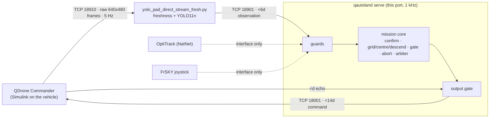
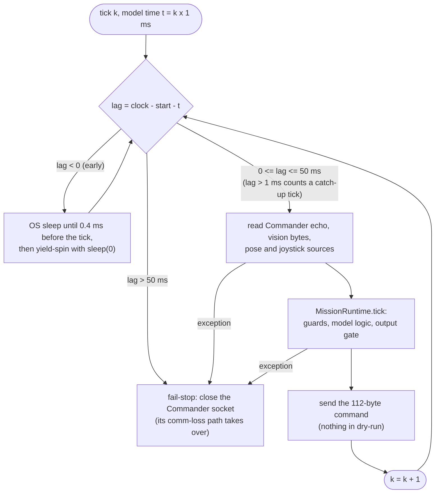

# Python port of the Phase 10 mission server

`src/qdrone_autoland` is a Python port of the Phase 10 mission server, the
`simulink/Mission_Server_QDrone_YOLO_Autonomous_Land.mdl` model. It talks to
the unchanged vehicle model (`simulink/QDrone_YOLO_Direct_Stream_Commander.mdl`)
and the unchanged vision publisher (`python/yolo_pad_direct_stream_fresh.py`)
using their exact wire formats.

**It has not flown.** No MATLAB, Simulink, QUARC or lab hardware was used.
There is no OptiTrack (NatNet) client or game-controller reader yet, so
`qautoland serve` reports `isTracking = 0` and a disconnected joystick, and
the Commander will not fly.



## Status

| Part | State | Evidence |
|---|---|---|
| Model reading | both `.mdl` files parsed directly by `tools/mdl_spec.py`. A compact spec is committed in `spec/`; `--full DIR` writes every block and line | `mdl_spec.py --check` in CI |
| Mission logic: 7 MATLAB Function blocks | ported, explicit state + `reset()` | Octave runs the chart code taken from the model. 30 committed sequences (188 k ticks): 27 exact, 3 grid sequences differ by at most 1.1e-16. All 8 closed-loop scenarios (1.81 M ticks) are exact |
| Block chains (convention correction, conditioning, home pose, joystick, comm loss) | ported from the block parameters | unit tests; not checkable against Simulink here |
| Original MATLAB tests | `test_phase9_landing_gate`, `test_phase9_abort_diagnostics` pass **unmodified** in Octave. The phase 10 dry run's behavioural half is re-run in Octave and its structural half is checked on the parsed model | `tools/octave/run_original_tests.m`, `tests/test_spec.py` |
| Model code vs `matlab/phase*.txt` templates | identical once `config_autonomous()` is substituted | `tools/octave/check_templates.m` |
| Wire formats (`<6d`, `<14d`, `<d`, column-major frames) | done | protocol tests; `yolo_pad_direct_stream_fresh.py` runs unmodified as a subprocess, fed synthetic frames over TCP 18910 |
| Tests | 189 pytest tests (Octave and vision ones skip without their tools) + the original `python/test_camera_freshness.py` | CI: lint + tests, Octave, vision, Windows |
| Safety layer (guards, output gate, fail-stop) | on the only runtime path | [SAFETY.md](SAFETY.md), fuzz and scenario tests; safety mutation sweep: 93 of 96 mutants killed (40 original, 21 written independently, 35 for checks added since); the 3 survivors are argued equivalent in `tools/mutation_sweep.py` |
| Logic mutation sweep | 62 of 66 killed (45 by the Octave fixtures alone). The 4 survivors are argued equivalent in `tools/mutation_sweep.py` | [mutation_logic.json](figures/data/mutation_logic.json) |
| Phase 10 autonomous LAND | ported faithfully, **off by default** (`--mode monitor`) | arbiter parity + scenarios |
| Sockets: mission server <-> Commander, <- publisher | done, loopback-tested | `tests/test_sockets.py`, `qautoland loopback` |
| Real-time loop | 1 kHz model time, hybrid sleep ([diagram](#real-time-loop)). Five 5 s dry runs on Linux: 16-18 % of one core, tick lag p50 35-37 µs, p99 49-53 µs. Windows CI runner, three runs: 15 %, 36 % and 33 % of one core, tick lag p99 0.32, 0.34 and 0.33 ms (runs 39493996791, 39500677539, 39510188039) | [serve_timing.png](#real-time-loop) from [serve_timing.json](figures/data/serve_timing.json) (`tools/serve_timing.py`); `tests/test_sockets.py`; the Windows CI job runs a 5 s dry run and fails if tick lag p99 reaches 5 ms |
| OptiTrack NatNet client, game-controller reader | **not implemented** (interfaces only, `io/sources.py`) | |
| Flight / QUARC / Simulink | **not run** | |

## Figures

All figures come from real runs of this code, made by
`python tools/make_figures.py` ([source](../tools/make_figures.py)) from the
committed data in [figures/data](figures/data); the numbers quoted with the
new ones are written to [visuals.json](figures/data/visuals.json) by the same
run. All closed-loop runs are software-in-the-loop against a simple stand-in
vehicle and camera (`src/qdrone_autoland/sim.py`). The stand-in is not a
flight model.

### Parity against Octave


*Source: `parity_figure`, data [parity.json](figures/data/parity.json)
(committed fixtures in `tests/fixtures/parity`, scenario fixtures from
`tools/make_fixtures.py --scenarios`).*

### The nominal mission

```mermaid
stateDiagram-v2
    direction LR
    s0: 0 grid search at 0.70 m
    s1: 1 centre at 0.70 m
    s2: 2 descend to 0.60 m
    s3: 3 centre at 0.60 m
    s4: 4 descend to 0.55 m
    s5: 5 low hover
    ready: landing ready
    land: LAND (Takeoff/Land 0)
    [*] --> s0: arm, takeoff
    s0 --> s1: pad confirmed<br/>(5 consecutive valid frames)
    s1 --> s2: centred, z at 0.70 m
    s2 --> s3: centred, z at 0.60 m
    s3 --> s4: centred, z at 0.60 m
    s4 --> s5: centred, z at 0.55 m
    s5 --> ready: landing gate:<br/>ten fresh aligned observations
    ready --> land: arbiter (autoland mode only)
```



*Descent stages of the grid manager (`logic/grid_manager.py`, `descentMode`
in the model), landing gate (`logic/landing_gate.py`) and arbiter
(`logic/arbiter.py`); the timeline below is this sequence in closed loop.*


*Source: `landing_xy_figure` and `landing_timeline_figure` on
`sim.run("nominal-autoland")`; the detections are the camera frames the YOLO
confirmation block consumed, replayed from its recorded inputs. Measured:
pad confirmed 19.46 s, landing ready 32.66 s, landed 34.86 s, touchdown error
22.6 mm, 0 ticks with the gate status not ok, final abort bits 8
([visuals.json](figures/data/visuals.json), `landing_xy`,
`landing_timeline`).*

### Pad positions

Across a 12 x 8 grid of pad positions (`python tools/pad_sweep.py`), 94 of
96 pads land with zero output-gate faults and 12-23 mm touchdown error
([pad_sweep.json](figures/data/pad_sweep.json)). The other two are never
confirmed by the model ([below](#what-the-models-reveal)). The right panel is
the same grid at `eec0a74` (`tools/pad_sweep.py --rev eec0a74`,
[pad_sweep_eec0a74.json](figures/data/pad_sweep_eec0a74.json)), before the
output gate's centring-entry check was anchored on the measured pose: 56 of
96 land and 38 stall on a refused centring entry.


*Source: `tools/pad_sweep.py` (data) and `pad_sweep_figure`.*

### Faults and the safety layer


*Source: `safety_figure`, data [scenarios.json](figures/data/scenarios.json).
The output gate's own states and an injected centring fault before and during
LAND are in [SAFETY.md](SAFETY.md#refused-centring-poses).*

Mutation sweeps: each rule is broken once and a test must fail. "parity"
means the Octave fixtures alone; "all" means the whole suite.


*Source: `tools/mutation_sweep.py` (data
[mutation_logic.json](figures/data/mutation_logic.json),
[mutation_safety.json](figures/data/mutation_safety.json)) and
`mutation_figure`.*

### Real-time loop



*`io/serve.py` (`MissionServer.run`, `step_once`). Missed ticks are run back
to back, so tick-based dwells keep their model-time meaning.*


*Source: `tools/serve_timing.py` (`qautoland serve --mode dry-run --duration 5`
locally, and the same statistics read from the Windows CI job logs of runs
39493996791, 39500677539 and 39510188039), data
[serve_timing.json](figures/data/serve_timing.json), plotted by
`serve_timing_figure`. Not timed on the lab PC.*

## Running it

```bash
python -m venv .venv && . .venv/bin/activate
pip install -e ".[dev]"                 # add ".[vision]" for the YOLO publisher
pytest -q                               # Octave and vision tests skip if octave-cli / ultralytics are missing
qautoland sim                           # all closed-loop scenarios, one JSON line each
qautoland loopback --duration 5         # publisher -> mission server -> Commander on 127.0.0.1 with fake peers
qautoland replay logs/yolo_direct_fresh_<stamp>.csv   # what the confirmation block makes of a recorded session
qautoland serve --mode dry-run          # real sockets, sends nothing
```

`qautoland serve` replaces the Simulink mission server: it listens on TCP 18001
for the Commander and connects to the publisher on 127.0.0.1:18901. Modes:

* `dry-run`: computes everything and sends nothing.
* `monitor` (default): Phase 9 behaviour. Only the operator lands.
* `autoland`: needs `--i-understand-autoland`. Faithful Phase 10.

On exit it prints its statistics, including CPU time and tick-lag
percentiles. The loop has been timed on Linux and in the Windows CI job,
not on the lab PC.

Regenerate the evidence:

```bash
python tools/mdl_spec.py                     # docs/spec from the .mdl files (--full DIR for every block and line)
python tools/make_fixtures.py                # Octave golden fixtures (needs octave-cli)
python tools/make_fixtures.py --check        # regenerate and compare (byte-identical with Octave 9.x)
python tools/make_fixtures.py --scenarios outputs/scenario_parity   # the eight closed-loop scenarios through Octave
python tools/mutation_sweep.py --sweep logic  --json docs/figures/data/mutation_logic.json
python tools/mutation_sweep.py --sweep safety --json docs/figures/data/mutation_safety.json
python tools/pad_sweep.py --json docs/figures/data/pad_sweep.json   # 96 closed-loop missions, about 30 s on 8 cores
python tools/pad_sweep.py --rev eec0a74 --json docs/figures/data/pad_sweep_eec0a74.json   # same grid, earlier gate
python tools/serve_timing.py --runs 5 --ci 39493996791 39500677539 39510188039 --json docs/figures/data/serve_timing.json
python tools/make_figures.py                 # every figure in docs/figures, plus data/visuals.json
```

More detail: [interfaces](INTERFACES.md), [safety layer](SAFETY.md),
model digests in [spec](spec).

## What the models reveal

These are facts about the saved models that matter for anyone flying this.
None was changed. The port reproduces them, and `test_sim.py` pins several of them.

* Every autonomous landing ends with `descentAbort` latched and abort bit 8,
  because the measured height drops below 0.45 m during LAND. The diagnostic
  therefore always reports an "abort" after a successful Phase 10 landing
  (bottom lane of the [nominal timeline](#the-nominal-mission): bit 8 sets
  during the descent after LAND).
* A NaN hold pose at centring entry makes the grid manager command
  (-1.2, -1.0, 0.7) with a NaN yaw: MATLAB `min(max(NaN, lo), hi)` gives `lo`.
  The centring origin is NaN as well, so the model's 0.5 m displacement limit
  never fires. This is reachable if the confirmation block captures a
  non-finite measured pose. In the port, the pose guard keeps NaN out of the
  model, and the output gate refuses the NaN yaw and any centring entry more
  than 0.5 m from where the vehicle is, and keeps its own 0.5 m limit around
  a finite origin ([SAFETY.md](SAFETY.md#centring-checks)).
* The YOLO confirmation needs 5 consecutive valid frames (any invalid frame
  resets the count), and the camera runs at 5 Hz. A pad near the edge of the
  search pattern can be in view for too short a time while the vehicle flies
  past. In the stand-in sweep, pads at (-1.1, -0.407) and (-1.1, -0.136) are
  in the camera footprint only on the leg through waypoint (-1.2, -0.333) and
  give 5 and 10 detections, in runs of at most 4. They are never confirmed;
  the search finishes and the model holds at its last waypoint (-1.2, 1.0,
  0.7). The port does the same as the model here, and the output gate refuses
  nothing in either run.

  

  *Source: `edge_pad_figure` (the counter is the ported confirmation block
  replayed on its recorded inputs); measured: 5 detections, longest run 4,
  never confirmed, 0 gate faults, final position (-1.2, 1.0, 0.7)
  ([visuals.json](figures/data/visuals.json), `edge_pad`).*
* The mission server's comm-loss warning is display only, and it appears only
  after the first recovery (Triggered Subsystem x Product). Its rule is
  `~(state == 2 && error >= 0)`, evaluated only after the first second
  (`time > 1`, a start-up inhibit). The Commander's rule is
  `state ~= 2 && error < 0` held for 0.1 s, evaluated after the first 3 s
  (`time > 3`), plus a data-loss check when the echoed timestamp stops
  changing for 0.5 s.
* The YOLO confirmation keeps `lastFrame` across takeoff cycles. A restarted
  publisher whose frame counter lands on the old value loses one frame.
* The mission server ignores the publisher's timestamp (`vision(6)`). The
  Python vision guard adds an age check against it.
* Dwell counts are in ticks (100 ticks = 0.1 s at 1 kHz), so the Python loop
  keeps exact model time.
* The OptiTrack block's calibration file is an absolute lab path
  (`Session 2026-09-15`), not `config/Calibration_2026-08-11.cal`.
* The Commander's external-mode target is 192.168.2.16, while
  `config_autonomous` says the QDrone is 192.168.2.15.
* The Commander's selector labelled "Data Out [14]" passes elements 1-13
  (tracking, triggers and poses); element 14, the timestamp, goes to a
  separate selector for the loopback echo. Only the label is misleading.
