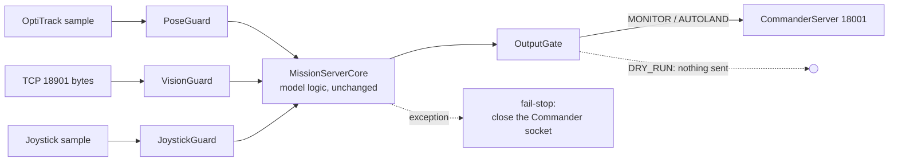

# Safety layer

The Simulink model has no input validation of its own: a NaN pose, a
corrupted observation or a stale joystick goes straight into the charts.
The Python port keeps the model logic exactly as it is (Octave parity) and
wraps it, on the only path from inputs to the Commander socket:

`runtime.MissionRuntime.tick` is the only place that turns raw inputs into a
packet, and both `qautoland serve` and the simulation call it, so every
scenario test runs through the guards.

| Component | Refuses | What the model then sees / what is sent |
|---|---|---|
| PoseGuard | non-finite, wrong shape, non-numeric, older than 50 ms (5 missed OptiTrack frames) | last good pose with `tracking = 0` (the grid manager latches its abort; the Commander errors on a tracking issue) |
| VisionGuard | non-finite, `detected` not 0/1, negative or fractional frame, confidence outside [0, 1], timestamp > 50 ms in the future, older than `yoloStaleSeconds` (0.5 s) | previous vector with `new = 0`. The backlog is drained and only the newest complete 48-byte record is used. Three structural refusals in a row = framing lost: buffer cleared and the socket reconnected |
| JoystickGuard | non-finite, not 32 buttons, nothing for 0.2 s | a disconnected controller (all axes -1), which drives the model's own joystick-issue path |
| OutputGate | desired pose non-finite, outside the saturation box (+-2 m), z outside [0.55, 0.70] m, centring step > 5 mm or z step > 0.15 m, more than 0.5 m from the centring origin; non-finite measured pose | last accepted desired pose; `isTracking = 0`. Arm, E-stop and joystick-issue bits are copied from the operator path in every mode; triggers are forced to 0/1 |
| MissionRuntime | any exception | returns None and latches `failed`; `serve` closes the Commander socket so the Commander's own comm-loss path (Error, then FLIGHT SAFETY stop after 1 s) takes over |
| MissionServer.run | more than 50 ms behind model time | fail-stop as above. Smaller lag is caught up tick by tick so tick-based dwells keep their meaning |

Bounds come from `config.py`: `ModelConstants` (values hard-coded in the
model) and `SafetyConfig` (Python-only thresholds). None of them is tighter
than anything the model itself commands in the closed-loop scenarios (all
eight scenarios run with zero gate faults).

## Modes

| Mode | Sends | Takeoff/Land (trigger 2) |
|---|---|---|
| `dry-run` | nothing | n/a |
| `monitor` (CLI default) | yes | always the operator's: Phase 9 behaviour, the arbiter's request is logged only |
| `autoland` (needs `--i-understand-autoland`) | yes | lowered when the Phase 10 arbiter lowers it, and only while the operator has arm and takeoff selected |

## Evidence

* `tests/test_safety.py`: every refusal reason; protected triggers pass in all
  16 operator combinations in every mode; random-input fuzz (3 seeds x 3
  modes x 4000 ticks of NaN/inf/garbage bytes/wrong types) never raises and
  never emits a non-finite or non-boolean field; E-stop reaches the wire
  within 0.2 s (+1 sample) of the button.
* `tests/test_sim.py`: E-stop, joystick disconnect, tracking loss, vision
  loss and malformed vision in closed loop.
* `tests/test_sockets.py`: fail-stop closes the Commander socket; overrun
  stops; no torn 112-byte records under back-pressure; dry-run sends nothing.
* `tools/mutation_sweep.py --sweep safety`: each rule above broken once.
