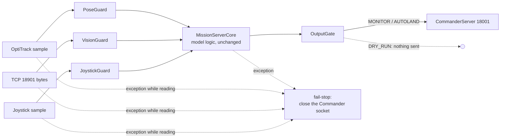

# Safety layer

The Simulink model has no input validation of its own: a NaN pose, a
corrupted observation or a stale joystick goes straight into the charts.
The Python port keeps the model logic exactly as it is (Octave parity) and
wraps it, on the only path from inputs to the Commander socket:

`runtime.MissionRuntime.tick` is the only place that turns raw inputs into a
packet, and both `qautoland serve` and the simulation call it, so every
scenario test runs through the guards.

| Component | Refuses | What the model then sees / what is sent |
|---|---|---|
| PoseGuard | non-finite, wrong shape, non-numeric, older than 50 ms (5 missed OptiTrack frames) | last good pose with `tracking = 0` (the grid manager latches its abort; the Commander errors on a tracking issue). A finite sample that Motive itself flags as not tracked keeps `tracking = 0` |
| VisionGuard | non-finite, `detected` not 0/1, negative or fractional frame, confidence outside [0, 1], timestamp > 50 ms in the future, older than `yoloStaleSeconds` (0.5 s) | previous vector with `new = 0`. The backlog is drained and only the newest complete 48-byte record is used. Three structural refusals in a row = framing lost: buffer cleared and the socket reconnected |
| JoystickGuard | non-finite, not 32 buttons, nothing for 0.2 s | a disconnected controller (all axes -1), which drives the model's own joystick-issue path. A malformed sample also discards the last good one |
| OutputGate | desired pose non-finite, outside the saturation box (+-2 m), z outside [0.55, 0.70] m; while centring: see [Centring checks](#centring-checks); non-finite measured pose; nothing accepted yet | last accepted desired pose (while centring: the centring hold below); `isTracking = 0` for a non-finite measured pose. Arm, E-stop and joystick-issue bits are copied from the operator path in every mode; triggers are forced to 0/1. There is no separate height-step limit: z is already confined to [0.55, 0.70] m and the model's abort hold legitimately steps 0.70 -> 0.55 m in one tick |
| MissionRuntime | any exception | returns None and latches `failed`; `serve` closes the Commander socket so the Commander's own comm-loss path (Error, then FLIGHT SAFETY stop after 1 s) takes over |
| MissionServer.step_once | an exception while reading the Commander socket, the vision socket, the pose source or the joystick source | fail-stop as above, with `stopped_reason = "input: ..."` |
| MissionServer.run | more than 50 ms behind model time | fail-stop as above. Smaller lag is caught up tick by tick so tick-based dwells keep their meaning |

Bounds come from `config.py`: `ModelConstants` (values hard-coded in the
model) and `SafetyConfig` (Python-only thresholds). None of them is tighter
than anything the model itself commands in the closed-loop scenarios (all
eight scenarios, and every pad position of the 96-pad sweep below, run with
zero gate faults).

## Centring checks

While the model is centring (`centeringActive`), the output gate checks each
desired pose. A centring phase starts on the first tick with
`centeringActive` set and ends on the first tick without it.

| Check | Limit | Measured from | Applies |
|---|---|---|---|
| entry jump | 0.5 m | where the vehicle is | until the gate has accepted a centring pose in this phase |
| step | 5 mm per tick | the last accepted centring pose, whatever was refused in between | after that |
| displacement | 0.5 m | the centring origin | on every centring tick once there is an origin |

So every accepted centring pose after the first is within 5 mm of the
previous accepted one, and, because a refused pose is replaced by that same
last accepted pose (below), within 5 mm of what was sent on the tick
before. A refused tick does not reset the reference: a 0.4 m jump is
refused on every tick it is offered, not accepted one tick late.

"Where the vehicle is" is the measured xy when it is plausible: tracked,
finite, inside the mission's flight area (`AutonomousConfig.x_limits`,
`y_limits`) grown by 0.25 m (`SafetyConfig.hold_area_margin_m`; the
vehicle overshoots edge waypoints), and within 0.1 m of the previous finite
measured sample (`SafetyConfig.hold_measured_jump_m`; one teleported
OptiTrack frame is not trusted). Otherwise it is the last accepted desired
pose.

The model's first centring pose is its hover-hold pose, captured from the
measured pose when the pad was confirmed, so it is always close to the
measured pose but can be far from the last waypoint the grid search sent:
the pad is often confirmed while the vehicle is still flying towards that
waypoint. Measuring the entry jump from the last sent pose would refuse
legitimate entries and stall the mission.

The entry check is what refuses the NaN hold pose: the model then commands
the flight-area corner (-1.2, -1.0, 0.7) with a NaN yaw (see
[PYTHON_PORT.md](PYTHON_PORT.md#what-the-models-reveal)). The NaN yaw is
refused by the finiteness check whatever the anchor.

The centring origin is the model's first centring pose if the gate accepts
it, otherwise where the vehicle is (as defined above, so never an untracked
or implausible measured pose), otherwise (nothing finite at all) the first
accepted centring pose. It is never non-finite.

### Refused centring poses

A refused centring pose is replaced by a hold:

* after the first accepted centring pose of the phase: that last accepted
  centring pose, which passed every check above;
* while the entry is still being refused: the plausible measured xy,
  clamped to the flight area (x -1.2..1.2 m, y -1.0..1.0 m, from
  `AutonomousConfig`; the 0.25 m allowance only decides whether a sample
  is trusted, it is never commanded), with the last accepted height and
  yaw, captured once on the first refused tick
  and kept (not re-captured as the vehicle moves) until centring ends. While
  no plausible measured xy is available the last accepted pose is sent
  instead and the capture is retried on the next tick, so a single bad
  OptiTrack sample never becomes, or persists as, the hold.

Refusals are never silent:

* The gate reports `status = "centring-refused"`. `qautoland serve` logs
  each status change (warning) and exposes `gate_status`,
  `centring_refusals` and `centring_escalations` in its statistics;
  `qautoland sim` and `loopback` report `gate_status` and `centring_refusals`.
* An accepted pose returns the status to `ok`. After 2 s of consecutive
  refusals (`SafetyConfig.centring_refusal_escalate_s`, 2000 ticks) the gate
  escalates to `status = "centring-fault"`: it logs an error, records the
  fault `centring-refusals-escalated` once (then `centring-fault-hold` on
  each held tick), and holds. The fault is latched until centring ends. In
  the model, centring ends only when the operator's Takeoff/Land input goes
  low, either by the operator or because a joystick issue forces it low;
  disarming or a descent abort alone does not end it. An accepted pose does
  not clear it.

The step limit is kept strictly, so if the model's own pose drifts more
than 5 mm away from the last accepted centring pose during a long refusal,
its later poses keep being refused and the gate escalates rather than
jumping to them. In the closed-loop scenarios and the 96-pad sweep the gate
refuses no centring pose at all.

`isTracking` is not withdrawn on escalation. The Commander's state machine
treats a tracking issue as an error and goes to its emergency path rather
than hovering, which is worse than a hold the operator can see and end with
their own Takeoff/Land or E-stop.

### Autonomous LAND and the gate status

In `autoland`, the gate applies a **new** autonomous LAND (lowers trigger 2
for the arbiter) only while its status is `ok`: not while centring poses
are being refused and not after a centring fault. The Takeoff/Land bit is
then the operator's.

A LAND the gate has already applied is never interrupted by the gate. In
the Commander's AUTO_LAND state a return of trigger 2 to 1 is an error and
an emergency stop ([INTERFACES.md](INTERFACES.md)), so raising it mid-landing
would turn a landing into a drop. While the arbiter keeps requesting LAND
and the operator keeps arm and takeoff selected, trigger 2 stays at the
model's LAND state (0) whatever the gate status; bad desired poses are
still refused and held as above, and a fault still escalates and is
reported. The LAND ends when the arbiter releases it or the operator drops
takeoff or disarms; the next LAND is a new one.

## Modes

| Mode | Sends | Takeoff/Land (trigger 2) |
|---|---|---|
| `dry-run` | nothing | n/a |
| `monitor` (CLI default) | yes | always the operator's: Phase 9 behaviour, the arbiter's request is logged only |
| `autoland` (needs `--i-understand-autoland`) | yes | lowered when the Phase 10 arbiter lowers it, and only while the operator has arm and takeoff selected; a new LAND only while the gate status is `ok` (see above) |

## Evidence

* `tests/test_safety.py`: every refusal reason; protected triggers pass in all
  16 operator combinations in every mode; random-input fuzz (3 seeds x 3
  modes x 4000 ticks of NaN/inf/garbage bytes/wrong types) never raises and
  never emits a non-finite or non-boolean field; E-stop reaches the wire
  within 0.2 s (+1 sample) of the button.
* `tests/test_sim.py`: E-stop, joystick disconnect, tracking loss, vision
  loss and malformed vision in closed loop; autonomous landing with zero
  gate faults on nine pad positions, including pads confirmed while the
  vehicle is still more than 0.5 m short of its waypoint or has overshot
  the flight area's edge; a centring fault during an autonomous LAND
  (desired x NaN for 2.5 s) never raises trigger 2 and the vehicle lands.
* `tools/pad_sweep.py`: the full 12 x 8 pad grid (x -1.1..1.1 m, y
  -0.95..0.95 m) in closed loop, results in
  [pad_sweep.json](figures/data/pad_sweep.json). 94 of 96 pads land, with
  zero gate faults and a touchdown error of at most 23 mm. The two that do
  not, (-1.1, -0.407) and (-1.1, -0.136), are never confirmed (see
  [PYTHON_PORT.md](PYTHON_PORT.md#what-the-models-reveal)); the gate never
  refuses anything in either run.
* `tests/test_sockets.py`: fail-stop closes the Commander socket (also when
  a pose, joystick or vision read raises); overrun stops; no torn 112-byte
  records under back-pressure; dry-run sends nothing; the loop does not
  busy-spin; centring refusals and their escalation show up in the serve
  statistics and log.
* `tools/mutation_sweep.py --sweep safety`: each rule above broken once.
