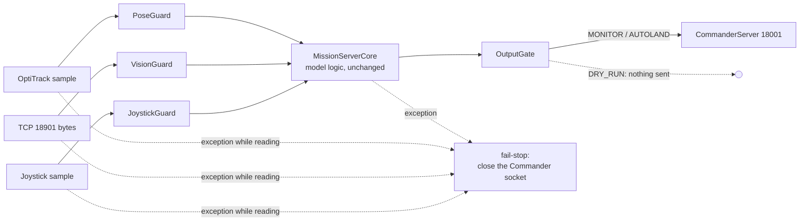

# Safety layer

The Simulink model has no input validation of its own: a NaN pose, a
corrupted observation or a stale joystick goes straight into the charts.
The Python port keeps the model logic exactly as it is (Octave parity) and
wraps it, on the only path from inputs to the Commander socket:

`runtime.MissionRuntime.tick` is the only place that turns raw inputs into a
packet, and both `qautoland serve` and the simulation call it, so every
scenario test runs through the guards.

| Component | Refuses | What the model then sees / what is sent |
|---|---|---|
| PoseGuard | non-finite, wrong shape, non-numeric, older than 50 ms (5 missed OptiTrack frames) | last good pose with `tracking = 0` (the grid manager latches its abort; the Commander errors on a tracking issue). A finite sample that Motive itself flags as not tracked keeps `tracking = 0` |
| VisionGuard | non-finite, `detected` not 0/1, negative or fractional frame, confidence outside [0, 1], timestamp > 50 ms in the future, older than `yoloStaleSeconds` (0.5 s) | previous vector with `new = 0`. The backlog is drained and only the newest complete 48-byte record is used. Three structural refusals in a row = framing lost: buffer cleared and the socket reconnected |
| JoystickGuard | non-finite, not 32 buttons, nothing for 0.2 s | a disconnected controller (all axes -1), which drives the model's own joystick-issue path. A malformed sample also discards the last good one |
| OutputGate | desired pose non-finite, outside the saturation box (+-2 m), z outside [0.55, 0.70] m; while centring: see [Centring checks](#centring-checks); non-finite measured pose; nothing accepted yet | last accepted desired pose (while centring: a hold where the vehicle is); `isTracking = 0` for a non-finite measured pose. Arm, E-stop and joystick-issue bits are copied from the operator path in every mode; triggers are forced to 0/1. There is no separate height-step limit: z is already confined to [0.55, 0.70] m and the model's abort hold legitimately steps 0.70 -> 0.55 m in one tick |
| MissionRuntime | any exception | returns None and latches `failed`; `serve` closes the Commander socket so the Commander's own comm-loss path (Error, then FLIGHT SAFETY stop after 1 s) takes over |
| MissionServer.step_once | an exception while reading the Commander socket, the vision socket, the pose source or the joystick source | fail-stop as above, with `stopped_reason = "input: ..."` |
| MissionServer.run | more than 50 ms behind model time | fail-stop as above. Smaller lag is caught up tick by tick so tick-based dwells keep their meaning |

Bounds come from `config.py`: `ModelConstants` (values hard-coded in the
model) and `SafetyConfig` (Python-only thresholds). None of them is tighter
than anything the model itself commands in the closed-loop scenarios (all
eight scenarios, and every pad position of the 96-pad sweep below, run with
zero gate faults).

## Centring checks

While the model is centring (`centeringActive`), the output gate checks each
desired pose against:

| Check | Limit | Measured from |
|---|---|---|
| entry jump | 0.5 m | where the vehicle is, on the first centring tick |
| re-anchor jump | 0.5 m | where the vehicle is, on the first tick after a refused centring pose |
| step | 5 mm per tick | the previous accepted desired pose |
| displacement | 0.5 m | the centring origin |

"Where the vehicle is" is the measured pose when it is finite and tracked;
only when it is not does the gate fall back to the last accepted desired
pose. The model's first centring pose is its hover-hold pose, captured from
the measured pose when the pad was confirmed, so it is always close to the
measured pose but can be far from the last waypoint the grid search sent:
the pad is often confirmed while the vehicle is still flying towards that
waypoint. Measuring the entry jump from the last sent pose would refuse
legitimate entries and stall the mission.

The entry check is what refuses the NaN hold pose: the model then commands
the geofence corner (-1.2, -1.0, 0.7) with a NaN yaw (see
[PYTHON_PORT.md](PYTHON_PORT.md#what-the-models-reveal)). The NaN yaw is
refused by the finiteness check whatever the anchor.

The centring origin is the model's first centring pose if the gate accepts
it, otherwise where the vehicle is, otherwise (nothing finite at all) the
first accepted centring pose. It is never non-finite.

A refused centring pose is never silent and never locks centring out:

* The gate holds the vehicle where it is (measured xy, last accepted height
  and yaw), not at an older, possibly distant target.
* On the next tick the new pose is judged against the measured pose again
  (re-anchoring), so one refusal does not make every later 5 mm step look
  like a jump.
* The gate reports `status = "centring-refused"`. `qautoland serve` logs
  each status change (warning) and exposes `gate_status`,
  `centring_refusals` and `centring_escalations` in its statistics;
  `qautoland sim` and `loopback` report `gate_status` and `centring_refusals`.
* After 2 s of consecutive refusals (`SafetyConfig.centring_refusal_escalate_s`,
  2000 ticks) the gate escalates to `status = "centring-fault"`: it logs an
  error, records the fault `centring-refusals-escalated` once (then
  `centring-fault-hold` on each held tick), and from then
  on holds where the vehicle is and **suppresses the autonomous LAND** (in
  `autoland` the Takeoff/Land bit is the operator's again). The fault is
  latched until centring ends (the operator lands, disarms or the mission
  aborts); an accepted pose does not clear it.

`isTracking` is not withdrawn on escalation. The Commander's state machine
treats a tracking issue as an error and goes to its emergency path rather
than hovering, which is worse than a hold the operator can see and end with
their own Takeoff/Land or E-stop.

## Modes

| Mode | Sends | Takeoff/Land (trigger 2) |
|---|---|---|
| `dry-run` | nothing | n/a |
| `monitor` (CLI default) | yes | always the operator's: Phase 9 behaviour, the arbiter's request is logged only |
| `autoland` (needs `--i-understand-autoland`) | yes | lowered when the Phase 10 arbiter lowers it, and only while the operator has arm and takeoff selected |

## Evidence

* `tests/test_safety.py`: every refusal reason; protected triggers pass in all
  16 operator combinations in every mode; random-input fuzz (3 seeds x 3
  modes x 4000 ticks of NaN/inf/garbage bytes/wrong types) never raises and
  never emits a non-finite or non-boolean field; E-stop reaches the wire
  within 0.2 s (+1 sample) of the button.
* `tests/test_sim.py`: E-stop, joystick disconnect, tracking loss, vision
  loss and malformed vision in closed loop; autonomous landing with zero
  gate faults on seven pad positions, including pads confirmed while the
  vehicle is still more than 0.5 m short of its waypoint.
* `tools/pad_sweep.py`: the full 12 x 8 pad grid (x -1.1..1.1 m, y
  -0.95..0.95 m) in closed loop, results in
  [pad_sweep.json](figures/data/pad_sweep.json). 94 of 96 pads land, with
  zero gate faults and a touchdown error of at most 23 mm. The two that do
  not, (-1.1, -0.407) and (-1.1, -0.136), are never confirmed (see
  [PYTHON_PORT.md](PYTHON_PORT.md#what-the-models-reveal)); the gate never
  refuses anything in either run.
* `tests/test_sockets.py`: fail-stop closes the Commander socket (also when
  a pose, joystick or vision read raises); overrun stops; no torn 112-byte
  records under back-pressure; dry-run sends nothing; the loop does not
  busy-spin; centring refusals and their escalation show up in the serve
  statistics and log.
* `tools/mutation_sweep.py --sweep safety`: each rule above broken once.
