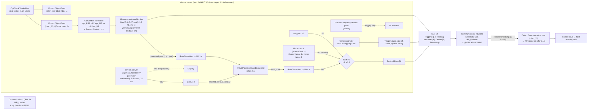

# Stage 6 Simulink model: extracted specification

Source: `reference/simulink/QDrone_YOLO_Stage6_RealYOLO_MonitorOnly.slx`, parsed
statically by `tools/slx_spec.py` (no MATLAB). The full machine-readable
output, with every block, parameter and line, is in
[`spec/QDrone_YOLO_Stage6_RealYOLO_MonitorOnly.json`](spec/QDrone_YOLO_Stage6_RealYOLO_MonitorOnly.json)
(402 blocks, 448 lines, 5 MATLAB Function charts). A summary for each of the
five models is in `spec/*.md`. `tests/test_spec.py` checks the facts quoted
below against the archive, and `python tools/slx_spec.py --check` fails if
the committed spec is stale.

Everything here is **what the model file shows**. Where QUARC block
semantics matter (Threshold boundaries, Stream Server buffering) they come
from QUARC documentation, not from running the model. Unknowns are listed
at the end.

## Block diagram (Stage 6, signal flow)

## Interfaces

| Interface | What the model shows | Missing / unknown |
|---|---|---|
| Detection input | QUARC Stream Server, `udp://localhost:5010?peer=any`, send = "Do not send data", receive = "Receive most recent data", `double`, default `[0 0 0]`, little-endian, receive buffer 256 B, blocking I/O in a separate thread, sample time 0.033 s. Output `rcv` → Demux → `detected`, `error_x`, `error_y`. | The sender (YOLO process) is not in the repo: its rate, timestamps, confidence threshold and image size are unknown. Implemented here as 3 little-endian float64 (24 bytes) per datagram, which is what the block decodes. |
| QDrone link | Stream Server with `uri_source = External input port`, URI from the Model Argument `URI_Follower` = `tcpip://localhost:18002` (ExtModeMexArgs). Sends the 14-element Mux, receives 1 double (the echoed timestamp → loop-back time). Sample time `qc_get_step_size` (0.001 s). | Send data type is "Inherited via back propagation" (not resolvable without compiling); the vehicle model `Commander_Stabilizer_QDrone_Follower.mdl` is not supplied. The dialog URI `tcpip://localhost:18877` is ignored. |
| QBot link | Same block, `URI_Leader` = `tcpip://localhost:18001`. | Same. |
| Host Initialize (joystick) | `uri_source = Use external mode communications` (its dialog URI 18001 is ignored). | — |
| OptiTrack | QUARC OptiTrack Trackables, rigid bodies `[1,2]`, sample `qc_get_step_size*10` (0.01 s), calibration `C:\Users\user\Documents\OptiTrack\Session 2026-06-09v2\Calibration Exceptional (MeanErr 0.538 mm) 2026-06-09 3.cal`, trackables `RigidBody 02.tra`. QBot = body 1, QDrone = body 2. | Machine-specific absolute paths. Motive API is Windows-only. |
| QDrone packet (14) | `[arm, takeoff, abort, joystick_issue, isTracking, x, y, z, yaw, x_d, y_d, z_d, yaw_d, timestamp]` (root Mux in1..in5 from mission outputs 1–5). | Wire types. |
| Solver | Active config set `configSet2` ("Configuration2"): FixedStep 0.001, ode2, `quarc_win64.tlc`, multitasking. | — |

## Interlocks and transforms (as wired)

* **Joystick** (FrSKY mapping): button 1 → E-stop through a 0.2 s Threshold;
  button 2 → arm; `Rz >= -0.5` → takeoff; throttle = 0.5·x + 0.5, yaw = −Rx,
  roll = y, pitch = z with ±0.01 dead zone; *joystick issue* = all six axes
  equal −1 for 0.2 s; triggers are `[arm·ok, takeoff·ok, abort, issue]`.
  Ported in `blocks/joystick.py` (not oracle-verified).
* **Communication loss**: chart_33 (`time > 1 && !(state == 2 && error >= 0)`)
  → QUARC Threshold ≥ 0.5 held 0.1 s → floor → *Comm Issue*. Ported with
  Octave parity for the chart; the Threshold is reproduced from its
  documentation.
* **Convention correction**: `R = [0 -1 0; 0 0 1; -1 0 0]`, position and
  rotation vectors multiplied by Rᵀ, then a QUARC Euler conversion ("Prevent
  Gimbal Lock"). Rᵀ is ported; the Euler step is not (conventions unverified).
* **Measurement conditioning**: Demux `[3 3 1]`, bias `[0 0 -0.07]`,
  saturation `[-2 -2 0]..[2 2 5]`, yaw = rot(3) unwrapped by Inverse
  Modulus 2π.
* **Home pose**: latched when Clock > 5 s and a one-shot on the arm rising
  edge; z + 1 m. **Follower trajectory**: distance 0.15 m, tolerance 0.15 m,
  height 1.25 m, heading 0.

## Findings

* **F1. Desired pose in Stage 6 is a scalar mode value, not a pose.**
  `Switch1` (criteria `u2 > 0.5`) gets `use_yolo = 0` on u2, the YOLO
  `cmd_pose` on in1, and on in3 the output of the *Mode switch*
  (a ManualSwitch between Custom Mode = 1 and Home Mode = 0). The scalar
  expands, so with `use_yolo = 0` the QDrone is sent Desired Pose
  `[m, m, m, m]` (m ∈ {0, 1}). In the preceding Integration model in3 came
  from the follower/home `Switch` (a real pose); in Stage 6 that pose only
  reaches logging (Mux in10). This looks like an accidental rewire. The
  Python port reproduces it in `stage6_desired_pose()` and the safety gate
  never forwards it.
* **F2. A stale detection is reused forever.** The Stream Server's `new`
  output only goes to a Display; the controller sees the last received
  packet every 33 ms even if the sender died. With a centred last packet the
  counter keeps growing and state 3 persists (see the replay plot).
  `CommandGate` rejects detections older than 0.2 s.
* **F3. Communication loss only raises a host warning.** Comm Issue is ANDed
  with a falling-edge-triggered counter and ORed into a warning display; it
  does not gate the commands sent. Enforcement is presumably in the vehicle
  model, which is not supplied.
* **F4. Rate transitions.** Stage 6 runs the generator at 0.033 s (measured
  pose → Rate Transition 0.033) and returns at 0.001 s. In the Integration
  model the two rate transitions were swapped.
* **F5. Monitor-only is a constant.** `use_yolo = 0`, `enable_descent = 0`
  inside chart_51. Nothing else in the model distinguishes monitor-only.

## Unknowns that the files cannot answer

* Wire data types of the QDrone/QBot packets (inherited types).
* The YOLO sender: rate, timestamp, confidence threshold, image size,
  class id. The chart hard-codes a 640×480 image centre.
* Exact QUARC Threshold boundary behaviour (held `>` vs `>=` the duration).
* Euler conventions in "Prevent Gimbal Lock".
* Behaviour of the vehicle-side controller on comm loss or abort.
